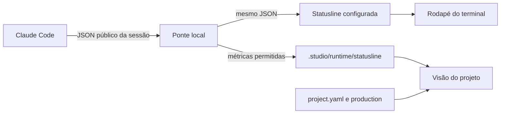

# Templates e telemetria do Studio Monitor

## Separação de responsabilidades

O aplicativo conecta pastas, controla sessões e apresenta dados. Um template fornece agentes,
skills, regras, documentação e configuração de trabalho. Instalar um template não muda a stack
nem inicia tarefas. O backend atual continua baseado no Claude Code; a independência entregue
é de domínio e organização do projeto, não suporte a todo provedor de inferência.

Cada pacote tem `template.json` e `files/`. O manifesto identifica versão, origem, licença,
requisitos, comandos sugeridos e regras declarativas de monitoramento. Os arquivos de conteúdo
não são instruções de implementação do próprio Studio Monitor.

- `templates/game-studios`: cópia de Donchitos no commit `05ad7c8a5b8aa2aa86bbd3439ae7cf7295cac418`.
- `templates/software-factory`: conteúdo de domínio próprio para software.
- `templates/shared/statusline-bridge.py`: ponte de métricas instalada pelo aplicativo.

A licença MIT original fica dentro do pacote do Game Studios e é copiada para
`.studio/licenses/game-studios.txt` no destino. Arquivos existentes de licença do projeto não
são substituídos. O código e a statusline originais do template de jogos não são reescritos;
a configuração instalada envolve o comando com a ponte de telemetria.

## Instalação

1. O usuário escolhe um template e uma pasta pelo seletor nativo.
2. A prévia registra os bytes atuais e classifica cada destino: novo, mesclar, preservar ou idêntico.
3. `CLAUDE.md` recebe o conteúdo em um bloco identificado quando já existe, preservando os imports relativos à raiz.
4. A mesclagem de settings mantém as escolhas existentes, acrescenta hooks/negações e não amplia a lista `allow` existente.
5. Ao confirmar, o instalador verifica novamente os arquivos e usa um lock no projeto. Se algo mudou, exige outra prévia.
6. Escritas novas usam criação exclusiva. Uma falha tenta reverter somente o que a instalação escreveu e ainda não foi alterado por outro processo. Diretórios vazios podem permanecer após rollback.

Links simbólicos nos destinos são recusados. Conflitos de scripts preservam a versão do usuário
e desabilitam a ativação automática dos novos hooks. Configurações que não sejam JSON simples
são preservadas e exigem integração manual. O instalador não executa hooks nem agentes.

O registro `.studio/template.json` serve para identificar a instalação. Ainda não há troca de
pacote ou atualização automática que sobrescreva personalizações. Um template diferente deve
ser instalado em outro projeto até existir um fluxo explícito de migração.

## O que a statusline faz

Segundo o [contrato do Claude Code](https://code.claude.com/docs/en/statusline), o CLI entrega
JSON ao comando local e exibe sua saída no rodapé. Esse processo não consome tokens de API.

O [script do Donchitos](https://github.com/Donchitos/Claude-Code-Game-Studios/blob/05ad7c8a5b8aa2aa86bbd3439ae7cf7295cac418/.claude/statusline.sh)
mostra uso da janela de contexto, modelo e posição no processo. Em rigor mínimo, pode mostrar
`Minimal · brief` ou a relação de histórias concluídas. Nos níveis relevantes, pode acrescentar
épico, feature e tarefa. Ele não é um medidor de saldo da assinatura nem um orquestrador de agentes.

A fábrica de software tem uma implementação própria com fase, rigor, progresso e trabalho ativo.

A ponte preserva a saída do script, grava de forma atômica e usa o identificador da sessão.
O aplicativo valida projeto e sessão antes de exibir as métricas. Os dados permitidos são modelo,
contexto, contagens de tokens e custo estimado da sessão. Texto de prompt, histórico, credenciais
e saída arbitrária de scripts não são persistidos pela ponte.

A visão do projeto relê os dados a cada cinco segundos. Isso depende de a statusline realmente
ser executada. Em modo SDK/headless, use os tokens observados como informação parcial; não
invente um percentual. A cota de cinco horas/semanal segue no medidor de conta, por consulta
independente ao `/usage` do CLI.

## Rigor e esforço são controles diferentes

Rigor define documentação, revisão e evidências do template. Esforço controla quanto o modelo
raciocina, pelos níveis aceitos no Claude Code. O app salva a escolha de esforço e mostra a
aplicação informada pelo CLI; um modelo ou política pode limitar o valor solicitado.

Fonte: [configuração de modelo e esforço](https://code.claude.com/docs/en/model-config).

## Statusline própria e métricas sem terminal

Ao conectar um projeto — e ao reabrir o projeto salvo — o Studio instala
`.studio/studio-statusline.py`, configura o comando no projeto e inclui os dados de
runtime no `.gitignore`. O comando anterior permanece encadeado: a linha Studio
aparece antes da saída existente. Permissões e hooks existentes são preservados.
Instalar novamente não cria cadeias repetidas. Arquivos personalizados conflitantes
ou links simbólicos geram um aviso em vez de serem sobrescritos.

A linha Studio mostra modelo, contexto fornecido pelo Claude Code, etapa atual e
quantidade de agentes quando há uma leitura recente do monitor. Sem esse dado, usa
`--`; não inventa atividade ou porcentagem. A etapa também pode ser identificada no
registro de trabalho atual, mesmo sem o app aberto. A execução desse script é local.

As execuções feitas no aplicativo gravam somente métricas públicas recebidas do SDK em
`.studio/runtime/statusline-sdk/<sessão>.json`. Isso independe de a interface do Claude
executar sua statusline. O painel usa a leitura válida mais recente da mesma sessão,
separando medições nativas e estimativas calculadas com a capacidade informada pelo
modelo principal. Prompts, conteúdo das respostas e credenciais não entram nesses arquivos.

## Etapa atual e backlog documental

A fase de produto configurada em `project.yaml` permanece separada da etapa de trabalho.
O monitor lê `currentPhase`/`workStage` do estado de produção ou configuração e o primeiro
item em `Current task` de `production/session-state/active.md`. Adequações e revisões
documentais recebem uma indicação identificada como inferida. Histórico de tarefas
concluídas não determina a etapa. **Ajustar etapa** salva uma escolha local por projeto
no Studio; **Usar etapa dos arquivos** remove essa escolha.

A aba **Backlog** reúne histórias e documentos de índices, com busca, tipos, estados,
ordenação, visualização em lista/quadro, responsáveis, prioridades, dependências e
itens marcados quando declarados. Clicar abre o documento ou o índice que registra
uma entrega ainda sem arquivo. `Designed` é mapeado para pronto para revisão, não
para aprovado. `In Design` indica elaboração/adequação. As fontes continuam visíveis.
